[TOC]


# 前言

众所周知，trace 在算法分析中的地位举足轻重。但在 iOS 上，用 Frida Stalker 不够稳定、也容易被检测到；用 unidbg 或 chomper 又得补一大堆环境。所以今天，Ta来了！Ta 来了！Ta带着 QBDI 和 Dobby 走来了，不仅有着简单的界面，还有着实实在在的功能。

这是本人在二进制分析过程中结合大模型开发的一个工具，欢迎大家交流学习，后续会考虑公布源码。


## QBDI 是什么

QBDI（QuarkslaB Dynamic binaryInstrumentation）是一款动态二进制插桩框架。简单说，它能把一段代码"托管"到自己的虚拟环境里执行，每执行一条指令都回调一次——于是你就能逐条指令地观察目标代码怎么跑、寄存器和内存怎么变，而不用改动原始二进制。

早期 QBDI 在 iOS 中支持有限，但官网最新版已经正式支持 **iOS ARM64**。这也是本项目选择它的直接原因：能在越狱 iPhone 上稳定地做指令级 trace。


## 为什么还要配合 Dobby

QBDI 只解决"逐条指令记录"这件事，但它本身**不负责把自己挂到目标代码上**——你得先有办法在某个地址"插一脚"，把控制权交给 QBDI。

这一步就交给 [Dobby](https://github.com/jmpews/Dobby)。Dobby 是一个 inline hook 库，负责在指定地址下钩子。二者分工很清晰：

- **Dobby**：在 `模块基址 + 起始地址` 处 hook 住，作为进入点。
- **QBDI**：命中后接管执行，从起始地址逐条 trace 到结束地址。

一个管"从哪进"，一个管"怎么记"，配合起来才能实现"在函数中间任意一段，逐指令 trace"的效果。


# trace 输出格式

每 trace 到一条指令，日志里会输出一行，格式如下：

```
0x<动态地址> (<模块名>!0x<静态地址>): <汇编指令>   {变化的寄存器: 值, ...}
```

- **动态地址**：这条指令运行时的实际地址（已含 ASLR slide）。
- **模块名!静态地址**：换算回相对模块基址的偏移，方便直接对照 IDA/Ghidra 里看到的地址。
- **汇编指令**：这条指令的反汇编。
- **末尾大括号**：寄存器的值。

为了让日志不至于爆炸，寄存器采用**增量输出**：

- **第一条指令**会完整打印全部 32 个通用寄存器（`x0`–`x28`、`fp`、`lr`、`sp`）的初始值。
- **之后每一条**只打印相比上一条**发生了变化的寄存器**——一眼就能看出这条指令改动了什么。若某条指令没有改动任何寄存器，则大括号省略。

寄存器值统一以 16 位十六进制显示（如 `0x000000016fdff8a0`）。


# 向量寄存器

向量寄存器 `v0`–`v31` **默认就会记录**。它们和通用寄存器一样采用增量输出，但单独占一行、以 `V{...}` 开头：

```
0x<动态地址> (<模块名>!0x<静态地址>): <汇编指令>   {变化的通用寄存器: 值}
   V{变化的向量寄存器: 值, ...}
```

每个向量寄存器是 128 位，以 32 位十六进制显示（高 64 位在前、低 64 位在后）。

> 以前需要在「记录内容(logMask)」里手动勾选，现在那一栏已经去掉了 —— 统一按「指令 + 向量寄存器」记录，不用再选。
>
> 旧配置里如果没开向量寄存器，**打开那条规则的编辑页、点一次「完成」** 就会跟着改过来；从没编辑过的旧规则仍按原来的设置跑。


# 基础使用

插件顶部有一个总开关，它是所有规则的总闸。关闭时，即使 trace 条目已经配好，规则也不会生效。所以开始 trace 前，先确认总开关是打开的。

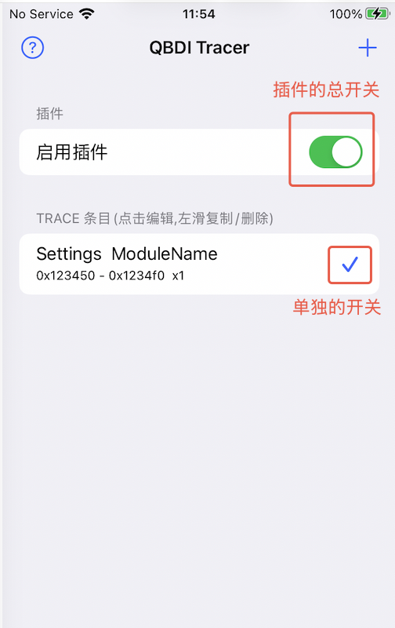


在某条 trace 条目上**右滑**，可以停用或启用这条规则。保存成功后会明确提示；引擎只在目标 App 启动时读取配置，因此需要彻底结束并重新打开目标 App 才会生效。

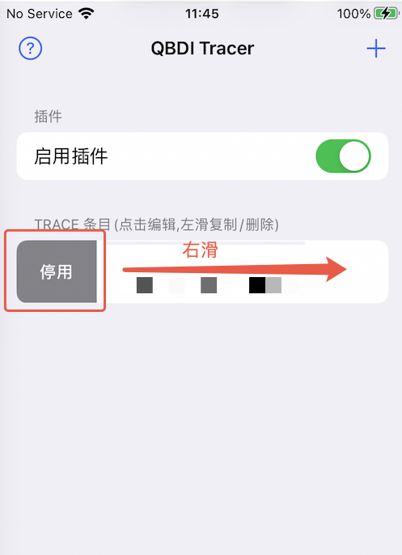

在某条 trace 条目上**左滑**，则可以命名、导出、复制或删除这条规则。自定义名称只用于区分条目，留空保存即可清除；旧版 JSON 没有名称也可以继续使用。

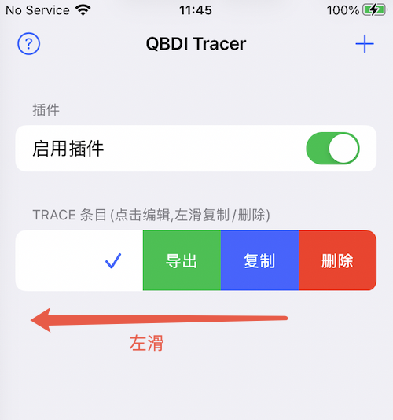


# 添加 trace 规则

如果之前创建并导出过规则，直接选 **【导入 Tracer】** 就能复用，省去重新配置。下面介绍从零创建一条新规则。


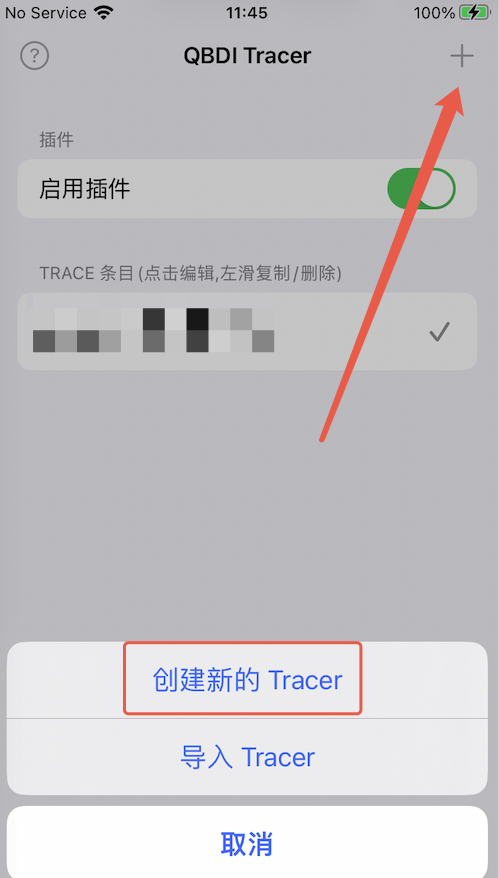


进入后，先选定要 trace 的目标 App，再填入目标模块名，以及 trace 的起始地址和结束地址。

其中「延迟」是指等程序启动、加载完相关库之后再开始 trace，留几秒缓冲能避免模块还没就位就 hook 失败。「Trace 次数」可以设置为 1–16，表示成功运行到结束地址的记录次数。

> **结束地址至少要比起始地址大 0x10（4 条指令）。**
>
> hook 用的补丁会覆盖起始地址往后 0x10 字节，这段的原指令被搬到了别处。如果结束地址落在这 0x10 字节之内，trace **永远碰不到结束点**，会一直往下执行整个函数、跑进后面所有被调用的函数，最后大概率崩溃退出（日志里出现 `[crash] signal=11`）。
>
> 填得太短时点「完成」会被挡下并提示；万一是手工改的 json，引擎在启动时会跳过这条规则并在日志里写明原因。
>
> 想看某一条指令附近的数据，别靠缩小 trace 区间，用**监视（watch）**更合适 —— 见下文「添加监视」。

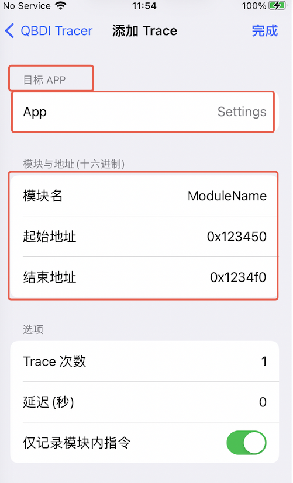


## 触发条件（只在数据对得上时才记录）

同一个地址常常会被调用很多次，但只有少数几次带着你要的数据。比如下面这条监视，大部分时候是空的：

```
[watch MusicallyCore+0x26ae3430] get_seed. MW  [x2+0x10]=0x0 (null)
```

只有偶尔那么一次才是真东西：

```
[watch MusicallyCore+0x26ae3430] get_seed. MW  [x2+0x10]=0x280691000
    0000000280691000  08 a4 8c 90 81 04 10 02 28 04 32 b0 01 82 cc 45  |........(.2....E|
```

这种情况下需要触发条件，否则第一次的空数据就会占掉记录机会。

在编辑 Trace 页的 **「触发条件(可选)」** 里点「添加触发条件」即可配置。条件数量不受限制；
有多条时是“或”的关系，满足任意一条就可以 Trace。没有任何条件就是无条件 Trace。
从第二条开始，页面会自动带入第一条的判断地址和取址表达式，方便连续添加相似条件。

| 字段 | 填什么 |
|---|---|
| 取址表达式 | 和监视里一样的写法，比如 `[x2+0x10]`。**留空 = 无条件**，就是以前的行为 |
| 判断地址 | 留空=起始地址；也可填 Trace 区间外的其他地址 |
| 匹配方式 | 非空 / 字节 / 字符串 / u64 |
| 期望值 | 按匹配方式填，「非空」不用填 |

四种匹配方式：

- **非空** —— 地址能读、而且不是 0 就算命中。上面那种 `(null)` 的调用光靠这一条就全滤掉了，不用填期望值。
- **字节** —— 比较二进制内容。按**内存顺序**写，和 hexdump 里看到的顺序完全一致。空格、冒号、逗号随便加（`08a48c90` 和 `08 a4 8c 90` 一样）。最多 32 字节。
- **字符串** —— 比较文本内容，比如 `api`、`https://`。
- **u64** —— 读 8 字节当整数比较。

> **要比二进制就选「字节」，别选「字符串」。** 选了「字符串」再填 `08a48c90`，它会拿 ASCII 文本 `"08a48c90"`（也就是 `30 38 61 34…`）去比内存里的 `08 a4 8c 90`，永远对不上。

**「字节」和「字符串」还要选匹配位置：**

| 位置 | 意思 |
|---|---|
| **开头** | 只比开头那几个字节／字符，完全相等才命中 |
| **包含** | 先读一段内容，看里面有没有出现要找的东西 |

选「包含」时会多出一栏 **「最长读取」**，也就是最多读多少字节来搜：

- **字节 + 包含** —— 从那个地址最多读这么多字节，在里面搜这串字节
- **字符串 + 包含** —— 先把字符串**完整读出来**（读到结尾的 `\0` 为止，最多读这么多），再看里面是否包含这段文字

默认 `0x100`（256 字节），最大 `0x1000`（4KB）。填得比要找的东西还短会被挡下 —— 那样永远搜不到。

缺省行为按最常用的来：**字符串默认「包含」、字节默认「开头」**。

> **「字节」和「u64」的写法是反的**，容易搞错：内存里是 `08 a4 8c 90 81 04 10 02` 时，
> 「字节」填 `08a48c9081041002`（照抄），「u64」要填 `0x02100481908ca408`（小端反过来）。
> 一般情况用「字节」就好。

> 「包含」几乎不比「开头」慢 —— 读一次内存的成本跟读多少字节关系不大，多出来的只是在内存里搜一遍。

条件不满足时会发生什么：

- **不写逐指令 trace 和监视内容** —— 只按 1、10、100、1000… 次输出精简诊断
- **继续等待后续匹配** —— 能稳稳抓到第一次真正匹配的调用
- 命中时会写出条件编号、匹配地址、匹配方式和同一线程的授权信息

**配错了怎么看出来。** 不匹配时会打一条诊断，告诉你表达式算出的地址、那里**实际**是什么、以及你要找的是什么：

```
[MusicallyCore] trigger miss #1: [x2+0x10] = 0x280691000
    want: bytes prefix 08a48c90
    got : 0000000028043200...  (read 0x4 bytes)
```

一眼就能分清是"地址取错了"还是"期望值写法不对"。如果连地址都算不出来，会改成列出每一级解引用读到了什么。

这条诊断按 **1、10、100、1000…** 次这样递增着打（不是每次都打），所以哪怕这个地址被调用几千万次，日志也就多几十行。

不想要某条条件时，在条件列表中左滑删除；全部删完后自动恢复为无条件 Trace。

**触发消耗策略：**

- **仅一次** —— 每条条件在当前目标 App 进程里最多促成一次成功 Trace。只有确实到达结束地址才会消耗；失败或提前停止会保留条件并归还 Trace 次数。重启 App 后重置。
- **可重复** —— 条件不会被消耗，可以反复匹配，直到完成设置的 Trace 次数。
- **自定义** —— 在每条触发条件的编辑页面分别填写“触发次数上限”，范围 `1–16`，默认 `1`。某条条件达到自己的上限后只停用该条件，其他条件仍可继续触发。一次 Trace 如果同时由多条条件授权，这些条件都会各记 `1` 次。切换到其他策略时会保留这些数值，但暂时不使用。

选择“自定义”时会弹出提示，引导你逐条进入触发条件编辑页面设置上限。Trace 总次数仍允许填写 `1–16`（包括 15 和 16），统计的是成功到达结束地址的次数；即使各条件上限合计更大，最终也不会超过 Trace 总次数。

> 判断地址留空时，条件用的是**起始地址那一刻**的寄存器值。自定义地址不能在起始和结束之间；不同触发地址彼此及与起始地址至少间隔 `0x10`。完全相同的触发地址会共享一个 Hook。自定义点命中后，只授权同一线程下一次到达起始地址时 Trace；因此高于结束地址的点可用于之后跳回低地址的流程。

> 每个不同的自定义判断地址会多安装一个 Dobby Hook。数值上虽在 Trace 区间外，如果 QBDI 跟随的动态调用路径又执行到该点，仍可能产生影响。优先选择 Trace 路径不会再次经过的控制流点，详见左上角「帮助 → 触发条件注意事项」。

起始地址、结束地址、判断地址和监视地址输入框下方都有 `0X 0-9 A-F` 快捷键，不需要反复切换手机键盘。

## Trace 内寄存器修改（只改变观测路径）

编辑 Trace 时可以添加“Trace 内寄存器修改”。它会在指定静态地址的指令**执行前**，
覆盖 QBDI 虚拟执行上下文中的寄存器，从而让同一段代码在 Trace 中走另一条分支；Trace
结束后入口现场会恢复，不会把这个寄存器值写回真实 App，也不会修改内存字节。

例如某处即将根据 `w8` 判断 `flag`，可以在该判断指令地址把 `x8` 选择为 32 位并写入
`0x2`。如果值是由上一条 `ldr` 或函数调用产生的，规则要设在**下一条指令**，否则当前
`ldr`/调用执行后会重新覆盖你的值。

| 字段 | 含义 |
|---|---|
| 启用 | 可临时停用单条规则而不删除 |
| 静态地址 | 当前 Trace 模块的相对地址；只有动态路径真正经过才生效 |
| 寄存器 | `x0`–`x28`（不含 `x17`）、`fp`、`lr` |
| 位宽 | 64 位写 `xN`；32 位写 `wN` 并清零高 32 位，`fp/lr` 只支持 64 位 |
| 写入值 | 十六进制值 |
| 应用方式 | 每次 Trace 仅一次，或该地址每次命中都覆盖 |

静态地址不强制位于起始/结束地址的数值区间，因为真实控制流可能跳到高地址或低地址；
但 QBDI 没有执行到该地址时规则不会生效。同一地址配置多条规则时按列表从上到下执行，
后面的规则可以覆盖前面的结果。修改点通过 QBDI 指令回调实现，不会在该地址额外安装
Dobby Hook，因此不受触发地址之间 `0x10` 补丁间距的限制。

> 这是“寄存器隔离”，不是完整沙盒。改变分支后，如果 Trace 内执行了文件写入、网络请求、
> 系统调用等外部操作，这些副作用不会自动撤销。`sp`、`pc` 和 Dobby 跳板占用的 `x17`
> 不允许修改；当前版本也不支持影子内存或任意内存字节修改。

命中时文件日志会记录规则编号、旧值、新值和应用次数；iPhone Console 会以
`[ios-qbdi-tracer]` 开头报告每条规则首次生效。`每次命中` 在热循环里的后续记录只写文件，
避免刷爆系统控制台。如果一轮 Trace 结束前始终没有执行到配置地址，Console 会明确输出
`NOT APPLIED`，方便区分“规则无效”和“动态路径没有经过”。更多说明可从左上角
“帮助 → Trace 内寄存器修改”查看。

## 添加监视

监视的作用，是当 trace 到某个地址时，把指定寄存器的值输出出来。输出形式可以按需选择，比如按字符串读取，或者以 dump 形式呈现。

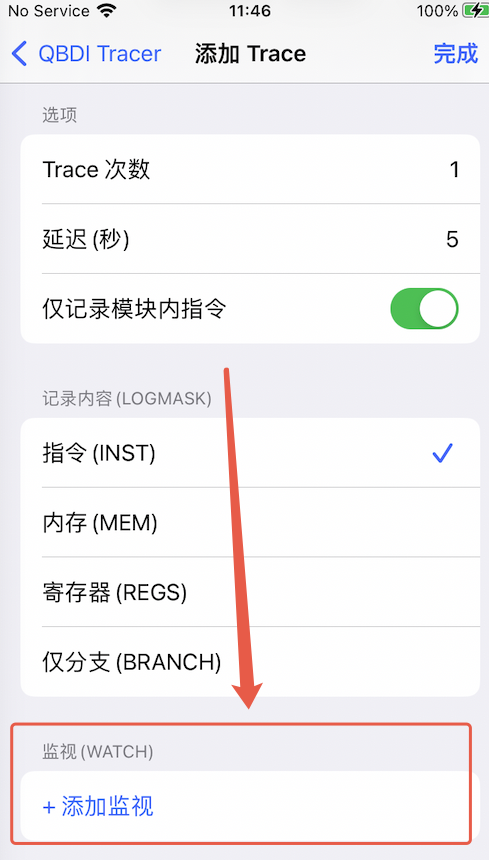


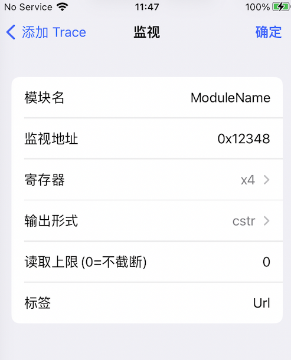


添加完成后，效果如下：

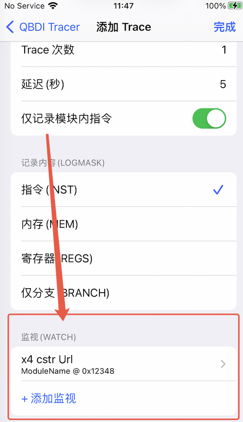


举个例子，配好下面这几条监视后，trace 日志里就会输出对应的数据：

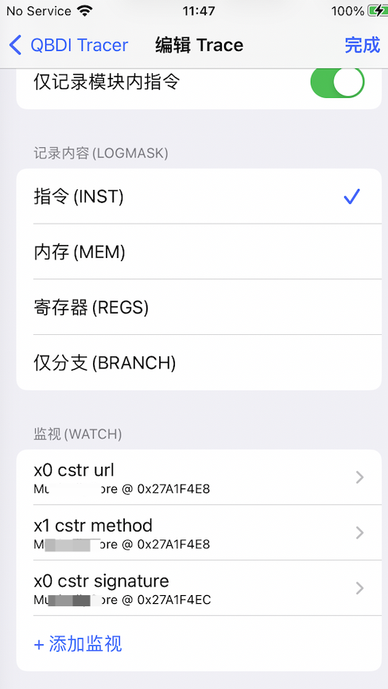


### 取址表达式（看结构体里的字段、往前 dump）

「寄存器/取址表达式」那一栏，除了直接选一个寄存器，还可以点最上面的 **✎ 输入取址表达式…** 自己写地址：

| 表达式 | 含义 |
|---|---|
| `x0` | 就是选寄存器 x0，和以前完全一样 |
| `x0-0x110` | x0 往前 0x110 字节处 |
| `sp+0x40` | 栈帧里的某个槽 |
| `[x0+0x10]` | 读 x0+0x10 处的 8 字节指针，再看它指向的内容 |
| `[[x0+8]+0x10]-4` | 连续两次解引用后再减 4 |

规则：

- `[]` 表示解引用（读 8 字节当指针），可以多层嵌套，最多 8 层。
- 数字**一律按十六进制**，`0x` 前缀可以省（`x0-110` 等于 `x0-0x110`）。
- 寄存器可用 `x0`–`x30`、`fp`、`lr`、`sp`、`pc`，大小写都行；`x29`/`x30` 就是 `fp`/`lr`。
- 表达式算出来的是**起始地址**，具体怎么读由「输出形式」决定 —— 所以 `[x0+0x10]` 配 `cstr` 的意思是"读结构体里那个 `char*` 字段指向的字符串"。
- 弹窗键盘上方有一条快捷栏，`[ ]`、`+`、`-`、`0x` 和所有寄存器都能点着输入，不用切键盘。语法不对时输入框会变红、「确定」按钮点不了。
- 表达式和"选寄存器"是二选一：选了寄存器就会清掉表达式。

如果某一级指针读不出来，日志会把每一级都列出来，方便看出是哪一层配错了：

```
[watch MusicallyCore+0x1a2b4] hdr [[x0+8]+0x10]-4 = <unreadable>
    x0        = 0x000000016fdd2a00
    deref#1 @0x16fdd2a08 = 0x0000000101a2c340
    deref#2 @0x101a2c350 = read failed
```

### 改了不想要?直接返回就行

编辑 Trace 和编辑监视这两个页面，**只有点右上角的「完成」/「确定」才算保存**。

改了内容之后如果直接返回（点左上角的 `<`），会弹框问一句是否放弃 —— 选「放弃」就恢复成你进来时的样子，选「继续编辑」就留在当前页。没改过任何东西时直接返回，不会打扰你。

> 两个编辑页都会禁用右滑返回，避免绕过保存/放弃确认；请用左上角的 `<` 退出。
>
> 一个例外：在监视页点过「确定」的改动就算定了，之后在 Trace 页选「放弃」不会把它撤回来。

### 读取上限 / dump 长度

这一栏现在按**十六进制**填：输入 `110` 会规范成 `0x110`（也就是 272 字节），想 dump 0x100 字节直接写 `100` 即可。填 `0` 表示不截断。

配合表达式就能"往前 dump"：表达式写 `x0-0x110`、输出形式选 `hexdump`、长度填 `110`，就是把 x0 之前那 0x110 字节全 dump 出来。hexdump 单次最多输出 0x10000 字节（64KB），超出会截断并在日志里标注。

> 旧配置里这一栏存的是十进制数字，打开表单时会自动换成十六进制显示（例如原来的 `272` 会显示成 `0x110`），**数值不变**，不用手动改。

若某个地址配置了监视点，会在该指令后紧跟一行 `[watch ...]` 输出对应寄存器解引用的内容（见上文ß「添加监视」）。

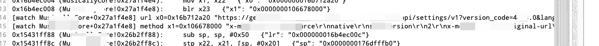

上面是输入，下面是签名结果，输入和输出一目了然，排查和追溯都很方便。

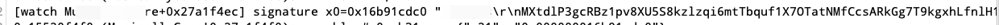


# 日志输出位置

逐指令 trace 日志会写到手机的 `/tmp/` 目录下。生命周期、hook 安装、trace 开始/结束、触发未命中、watch 读取失败和续跑异常也会同步到 iPhone 系统日志控制台，并统一以 `[ios-qbdi-tracer]` 开头，方便筛选。具体的文件命名规则，点击左上角的问号即可查看。

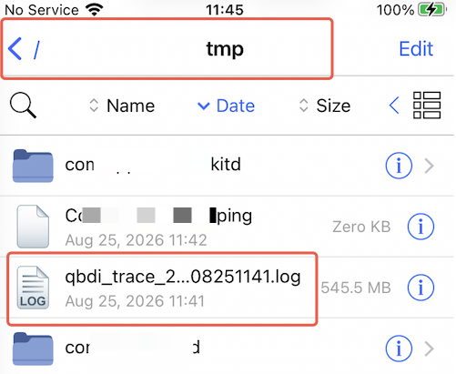
